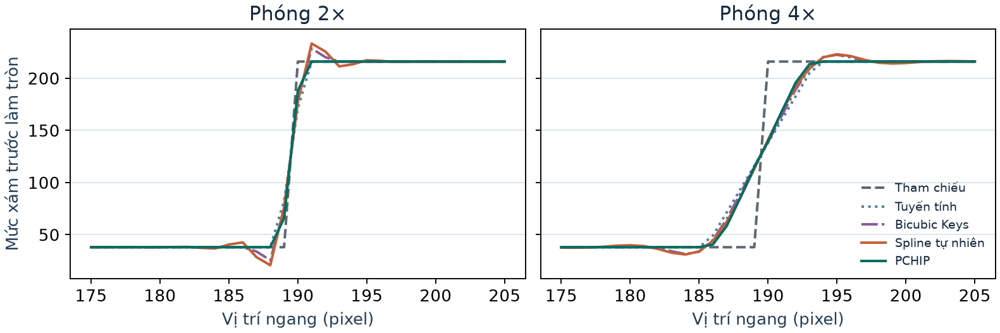
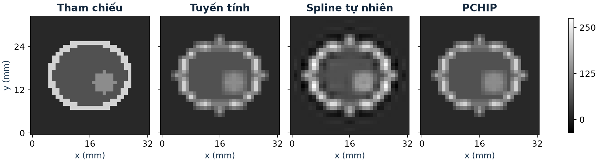
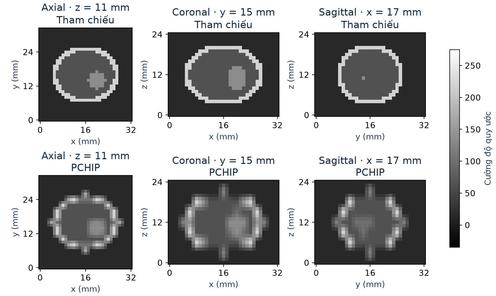

# Nội suy giữ dải mức xám và kiểm soát sai lệch spline 3D

Phần mở rộng dùng chung mã nội suy và bộ giải với [báo cáo chính](BAO_CAO_NGAY_14.md). **MAE** đo chất lượng nội suy so với dữ liệu tham chiếu. **Sai lệch bộ giải** đo độ chênh lớn nhất giữa Gauss–Seidel và Thomas trên cùng spline, trước lượng tử hóa.

## 1. Chia ngưỡng dừng cho hai lượt nội suy

Với \(R_x,R_y\) là phần dư lớn nhất của các hệ theo hàng và cột, chặn 2D là \((2{,}5R_x+R_y)/16\). Phân cho lượt ngang tỷ lệ \(\alpha\) của sai lệch cho phép \(\delta\) rồi đặt

$$
\tau_x=\frac{16\delta\alpha}{2{,}5},\qquad
\tau_y=16\delta(1-\alpha).
$$

Thế \(R_x\le\tau_x,\ R_y\le\tau_y\) vào chặn cho \(E_{2D}\le\delta\). Chọn \(\alpha=5/7\) thì hai ngưỡng bằng nhau, đúng cấu hình gốc. Ba cách chia còn lại là \(1/4,\ 1/2,\ 3/4\) để thử ưu tiên lượt dọc, chia đều mức sai lệch, và ưu tiên lượt ngang.

Giữ nguyên \(\delta=0{,}1\), ảnh biên và hoa văn ở \(4\times\), nghiệm đầu bằng 0 và tối đa 500 vòng mỗi hệ. Từ ảnh nhỏ \(96\times56\), xử lý 56 hệ theo hàng với 94 ẩn mỗi hệ, sau đó 384 hệ theo cột với 54 ẩn mỗi hệ. Đếm số lần cập nhật ẩn \(W=\sum_j n_j k_j\), với \(n_j\) là số ẩn và \(k_j\) là số vòng quét của hệ \(j\). \(W\) là thước đo khối lượng cập nhật, chưa bao gồm phép đo thời gian hay chi phí dựng ảnh.

| Phần sai lệch dành cho ngang | Cập nhật ẩn · Biên | Sai lệch · Biên | Cập nhật ẩn · Hoa văn | Sai lệch · Hoa văn |
|---|---:|---:|---:|---:|
| \(5/7\) · cùng ngưỡng | 57.120 | 0,010628 | 166.804 | 0,011788 |
| \(1/4\) | 57.932 | 0,027280 | **152.578** | 0,025858 |
| \(1/2\) | **55.590** | 0,018176 | 158.870 | 0,017856 |
| \(3/4\) | 57.836 | 0,008900 | 167.710 | 0,011788 |

Cả 8 ca đạt chặn. Trong số cấu hình đã thử, ảnh biên giảm **2,68%** số lần cập nhật ở \(\alpha=1/2\), ảnh hoa văn giảm **8,53%** ở \(\alpha=1/4\). Sai lệch đo được ở hai cấu hình này tăng so với mốc cùng ngưỡng và vẫn dưới mức \(0{,}1\). [Thử đổi cấu hình trong demo](demo.html)

## 2. PCHIP và độ vượt dải ở biên ảnh

PCHIP nối các đoạn Hermite bậc ba bằng giá trị và đạo hàm cấp một tại nút. Với bước nút \(1\), đặt \(s_i=f_{i+1}-f_i\). Nếu \(s_{i-1},s_i\) cùng dấu và khác 0, lấy trung bình điều hòa \(d_i=2/(1/s_{i-1}+1/s_i)\). Nếu có đoạn phẳng hoặc đổi dấu, đặt \(d_i=0\). Ở đầu dãy, ước lượng một phía \(d_0=(3s_0-s_1)/2\), đưa về 0 nếu khác dấu \(s_0\), và giới hạn độ lớn bởi \(3|s_0|\). Đầu kia xử lý đối xứng. Hai mẫu cho đoạn thẳng và một mẫu cho hằng số. [Fritsch và Butland, SIAM](https://doi.org/10.1137/0905021)

Với \(t\in[0,1]\), \(u=1-t\), đa thức trên đoạn \([i,i+1]\) là

$$
H_i(t)=(1+2t)u^2 f_i+(3-2t)t^2f_{i+1}+tu^2d_i-t^2u d_{i+1}.
$$

**Vì sao không vượt dải?** Nếu \(s_i=0\), hai độ dốc được chọn bằng 0 và đoạn là hằng số. Nếu \(s_i\ne0\), hai độ dốc chuẩn hóa \(a=d_i/s_i,\ b=d_{i+1}/s_i\) thuộc \([0,3]\). Đạo hàm \(H'_i/s_i\) phụ thuộc affine vào \(a,b\). Tại bốn góc \((0,0),(3,0),(0,3),(3,3)\), giá trị lần lượt là \(6t(1-t),\ 3(1-t)^2,\ 3t^2,\ 3(2t-1)^2\), đều không âm. Suy ra đoạn đơn điệu theo chiều của \(s_i\) và nằm giữa hai mẫu đầu mút. Theo từng lượt, dải cường độ toàn ảnh hoặc toàn khối nằm trong dải đầu vào, trong số học chính xác.

Chọn ảnh biên và nét mảnh vì hai mẫu có chuyển mức nhanh. Dùng cùng đầu vào trung bình khối và cùng tọa độ tâm pixel như báo cáo chính. Đo MAE sau chặn và làm tròn về 8 bit. Đo vượt dải \(O=\max(0,\min f-\min \widehat f,\max\widehat f-\max f)\) trên toàn ảnh trước lượng tử hóa, với \(f\) là **ảnh nhỏ đầu vào**. Giá trị \(O\) toàn ảnh có thể khác độ vượt dải của mặt cắt tại hàng 64.

| Ảnh · Mức phóng | MAE tuyến tính | MAE Keys | MAE spline | MAE PCHIP | \(O\) spline | \(O\) PCHIP |
|---|---:|---:|---:|---:|---:|---:|
| Biên · \(2\times\) | 0,3350 | 0,3336 | 0,3987 | **0,2363** | 25,95 | 0 |
| Biên · \(4\times\) | 0,8905 | 0,8434 | 0,8481 | **0,7143** | 17,46 | 0 |
| Nét mảnh · \(2\times\) | 8,6348 | 7,5106 | 7,7117 | **6,4913** | 43,84 | 0 |
| Nét mảnh · \(4\times\) | 15,4914 | 15,1636 | 16,4544 | **13,5812** | 58,38 | 0 |

## 3. Tái lấy mẫu khối phantom và tạo lát cắt

Phần này mô phỏng bước **tái lấy mẫu khối CT đã tái tạo**. Từ các voxel cường độ đã có, đổi lưới theo tọa độ vật lý rồi trích lát axial, coronal và sagittal để xem cấu trúc giữa các mẫu. Đây là thí nghiệm số trên hai khối tổng hợp, với cường độ quy ước. [3D Slicer, Resample Scalar Volume](https://slicer.readthedocs.io/en/latest/user_guide/modules/resamplescalarvolume.html)

| Thành phần | Điều kiện và lý do |
|---|---|
| Lưới tham chiếu | \(33\times33\times25\) voxel, bước \(1\times1\times1\) mm, gốc \((0,0,0)\). Kích thước cho phép giữ nguyên hai đầu mỗi trục khi lấy thưa. |
| Lưới đầu vào | \(17\times17\times9\), bước \(2\times2\times3\) mm. Trục \(z\) thưa hơn để mô phỏng khoảng cách lát khác khoảng cách trong mặt phẳng. Lấy giá trị đúng tại nút của khối tổng hợp. |
| Ba lượt nội suy | \(x\to y\to z\), kích thước trung gian \(33\times17\times9\), rồi \(33\times33\times9\), cuối cùng \(33\times33\times25\). Chuẩn hóa tọa độ truy vấn thành \(p_x=x/2,\ p_y=y/2,\ p_z=z/3\). Mỗi hệ spline dùng bước nút \(1\). |
| Đánh giá | Giữ 2.601 voxel đầu vào để kiểm tra khớp nút. Tính MAE số thực trên **24.624 voxel chưa cung cấp**, tức mọi vị trí chưa có mẫu ở ít nhất một trục. Đo vượt dải trên toàn khối đầu ra. |

**Hai khối tham chiếu.** Gaussian \(G=200\exp(-[(x-16)^2+(y-16)^2]/80-(z-12)^2/24)\) cung cấp một trường trơn. Phantom có \(\rho=((x-16)/12)^2+((y-16)/10)^2+((z-12)/9)^2\), với nền 15 khi \(\rho>1\), vỏ 220 khi \(0{,}73\le\rho\le1\), và lõi 65 khi \(\rho<0{,}73\). Trong lõi có một vùng 135 xác định bởi \(((x-20)/3)^2+((y-14)/3)^2+((z-11)/4)^2\le1\). Vỏ sáng và vùng chèn giúp quan sát sự khác biệt ở các biên và chi tiết nhỏ.

| Khối | MAE tuyến tính | MAE spline | MAE PCHIP | Vượt dải spline | Vượt dải PCHIP |
|---|---:|---:|---:|---:|---:|
| Gaussian trơn | 1,0022 | **0,0895** | 0,2856 | 0 | 0 |
| Phantom biên gắt | 11,5900 | 14,4058 | **11,2396** | 47,6797 | 0 |

### Chặn sai lệch bộ giải qua ba trục

Đặt \(X,Y,Z\) là các phép spline chính xác theo từng trục, \(\widetilde X,\widetilde Y,\widetilde Z\) là các lượt dùng Gauss–Seidel. Chặn 1D là \(R_a/16\) trên cùng đầu vào của lượt \(a\), và chuẩn của mỗi phép spline chính xác không vượt \(B=2{,}5\) trên lưới nút đơn vị. Chèn lần lượt các lượt dọc và sâu chính xác trên đầu vào trung gian đang dùng, với \(F\) là khối thưa.

$$
\begin{aligned}
\widetilde Z\widetilde Y\widetilde X F-ZYX F
={}&(\widetilde Z-Z)(\widetilde Y\widetilde X F)\\
&+Z\big[(\widetilde Y-Y)(\widetilde X F)\big]\\
&+ZY\big[(\widetilde X-X)F\big].
\end{aligned}
$$

Sai lệch ngang đi qua hai lượt chính xác, sai lệch dọc qua một lượt, sai lệch sâu đi thẳng ra đầu ra. Từ bất đẳng thức tam giác,

$$
E_{3D}\le\frac{B^2R_x+BR_y+R_z}{16}=\frac{6{,}25R_x+2{,}5R_y+R_z}{16}.
$$

Với \(w=(6{,}25,\ 2{,}5,\ 1)\) và tỷ lệ phân bổ \(\alpha_x+\alpha_y+\alpha_z=1\), đặt \(\tau_a=16\delta\alpha_a/w_a\). Nếu các hệ đều dừng với \(R_a\le\tau_a\) thì \(E_{3D}\le\delta\). Chia tỷ lệ theo \(w/9{,}75\) cho ngưỡng phần dư bằng nhau. Thử thêm chia đều mức sai lệch \((1/3,1/3,1/3)\), tăng theo lượt \((1/6,1/3,1/2)\) và ưu tiên \(z\) \((0{,}10,0{,}25,0{,}65)\). Lượt \(x,y,z\) có lần lượt 153, 297 và 1.089 hệ, nên hai cách cuối kiểm tra giả thiết rằng nới ngưỡng ở các lượt có nhiều hệ có thể giảm tổng cập nhật.

| Khối · \(\delta=0{,}1\) | Cấu hình tốt nhất trong các ca thử | Cập nhật · cùng ngưỡng → cấu hình chọn | Sai lệch cực đại | Chặn đo từ phần dư |
|---|---|---:|---:|---:|
| Gaussian | \((1/6,1/3,1/2)\) | 49.229 → 44.022 | 0,015196 | 0,097584 |
| Phantom | \((0{,}10,0{,}25,0{,}65)\) | 53.522 → 47.877 | 0,024180 | 0,097570 |

Cả **24 ca** gồm 2 khối, 4 cấu hình và 3 mức \(\delta=1;\ 0{,}1;\ 0{,}01\) đều thỏa chặn và mục tiêu. Ở phantom, sai lệch bộ giải \(0{,}024180\) là sai lệch giữa hai cách tính **cùng một spline**. MAE \(14{,}4058\) của spline trên cùng khối đo sai lệch **so với tham chiếu**. Hai phép đo lý giải vì sao siết ngưỡng bộ giải và chọn phương pháp nội suy là hai quyết định riêng.

## Tái lập kết quả

Chạy tại thư mục dự án. Bước tạo hình cần NumPy và Matplotlib.

~~~text
node --test verify.mjs
node run_advanced.mjs
python generate_advanced_figures.py
node build_demo.mjs
~~~

[Kết quả đầy đủ](results/advanced/KET_QUA_NANG_CAO.json) · [Dữ liệu dùng để vẽ](results/advanced/DU_LIEU_HINH.json)
