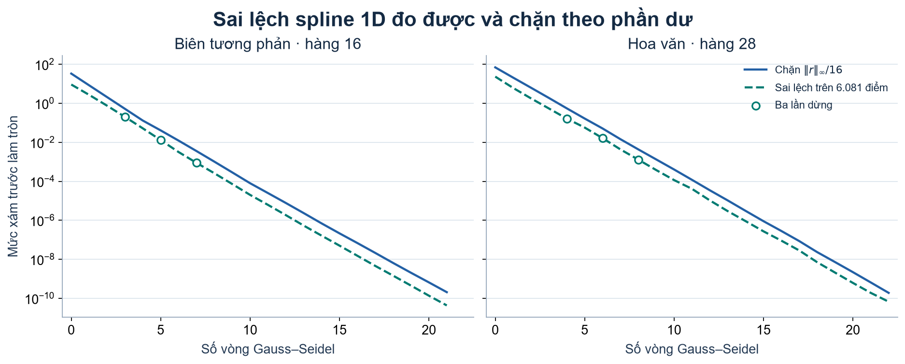
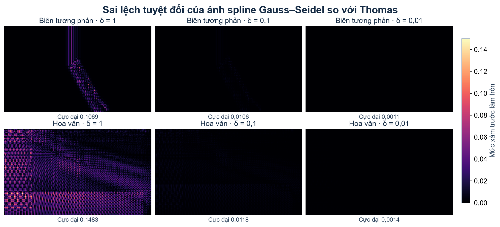
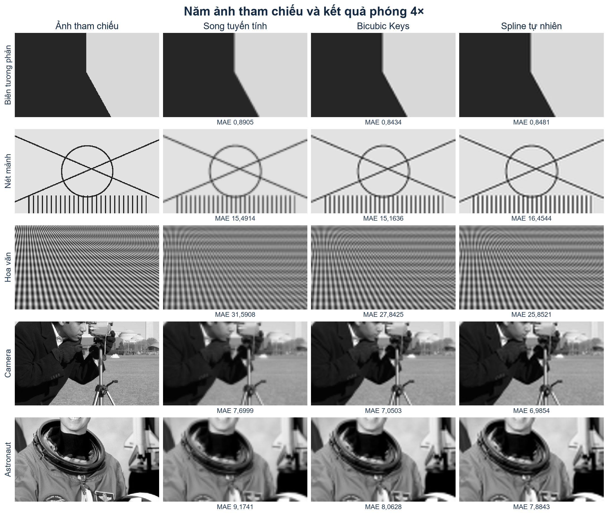
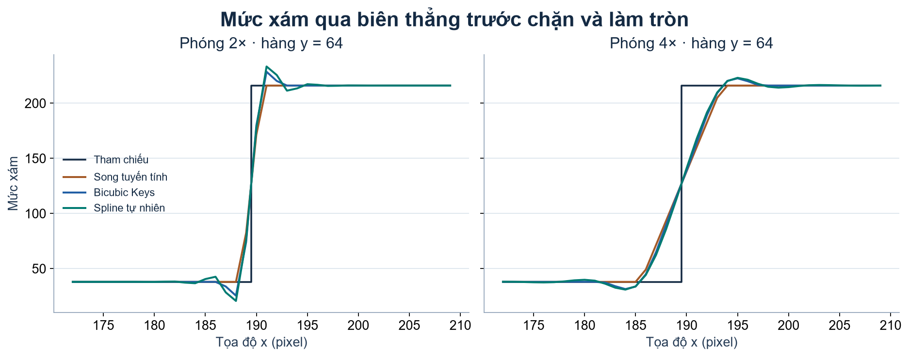

# Phóng to ảnh số bằng nội suy và kiểm soát sai số khi giải hệ spline

Bài thực nghiệm so sánh **song tuyến tính, bicubic Keys và spline bậc ba tự nhiên** ở mức phóng \(2\times\) và \(4\times\). Phần giải hệ đặt một câu hỏi riêng. **Nếu chấp nhận sai lệch \(\delta\) mức xám so với spline dùng Thomas, nên đặt ngưỡng dừng Gauss–Seidel bao nhiêu?**

[Demo offline](demo.html) cho phép thay phương pháp và mức phóng, rồi chọn \(\delta\) trên một hàng hoặc toàn ảnh. [Nhật ký ngày 1–7](BAO_CAO_NGAY_1_7.md) lưu các phép kiểm tra tính tay và đối chiếu bộ giải độc lập. [Tệp kết quả ngày 14](results/day14/KET_QUA_NGAY_14.json) chứa số liệu từng vòng, từng ảnh và cấu hình đầy đủ.

**Kết quả chính.** Trên bộ thử cố định, bicubic Keys có MAE thấp nhất ở 4/10 cặp ảnh–mức phóng, spline tự nhiên ở 6/10 cặp. Khi cố định mô hình spline, ngưỡng dừng Gauss–Seidel suy ra được từ sai lệch mức xám cho phép \(\delta\). Với ảnh hoa văn ở \(4\times\) và \(\delta=0{,}1\), sai lệch cực đại so với Thomas là \(0{,}011788\) mức xám, dưới chặn \(0{,}099184\).

## Thiết kế thí nghiệm

| Thành phần | Điều kiện | Lý do chọn |
|---|---|---|
| Ảnh tham chiếu | 5 ảnh xám \(384\times224\). Ba ảnh tự tạo gồm biên, nét mảnh và hoa văn. Hai ảnh chụp là Camera và Astronaut | Có các mẫu kiểm soát được để đọc hiện tượng và có ảnh chụp để thử kết cấu tự nhiên. Cả hai kích thước chia hết cho 2 và 4 |
| Tạo ảnh đầu vào | Trung bình từng khối \(s\times s\) không chồng lấn, \(s=2,4\). Giữ Float64 | Mỗi nhóm so sánh dùng cùng đầu vào. Giá trị trung bình có thể lẻ, nên giữ số thực qua các bước tính |
| Tọa độ và mép ảnh | Ánh xạ theo tâm pixel, chặn tọa độ vào miền tâm mẫu. Khi nhân trọng số ngoài miền, lặp mẫu sát mép | Tránh ngoại suy spline và giữ quy ước vị trí nhất quán |
| Spline tự nhiên | \(h=1\) theo tọa độ của lưới đầu vào, \(S''=0\) ở hai đầu mỗi dãy | Hệ có cấu trúc ba đường chéo cố định, cho phép suy ra chặn sai số cụ thể |
| Gauss–Seidel | Nghiệm đầu \(0\), quét từ trái sang phải, tối đa 500 vòng trên mỗi hệ | Cùng cách khởi tạo cho các ca thử. Giới hạn vòng giúp phát hiện ca chưa đạt ngưỡng |
| Mức sai lệch \(\delta\) | \(1;\ 0{,}1;\ 0{,}01\) mức xám trước làm tròn | Mỗi mức siết thêm một bậc thập phân. Có thể theo dõi số vòng khi cần độ chính xác dưới một mức xám |

Hai ảnh chụp được cắt vùng tâm \([64,448)\times[144,368)\) từ ảnh gốc \(512\times512\). Quy tắc chuyển xám là làm tròn \(0.299R+0.587G+0.114B\). [Danh mục dữ liệu và mã SHA-256](data/manifest.json) lưu nguồn và vùng cắt. [Camera, Lav Varshney](https://scikit-image.org/docs/stable/api/skimage.data.html#skimage.data.camera) · [Astronaut, NASA](https://scikit-image.org/docs/0.25.x/api/skimage.data.html#skimage.data.astronaut)

## Công thức dùng trong quy trình phóng ảnh

### Tạo đầu vào và ánh xạ tọa độ

Mỗi pixel của ảnh nhỏ là trung bình một khối trên ảnh tham chiếu.

$$
D_s[j,i]=\frac1{s^2}\sum_{a=0}^{s-1}\sum_{b=0}^{s-1}I[sj+a,si+b].
$$

Tọa độ nguồn của tâm pixel đầu ra \((u,v)\) được tính bằng

$$
x=\frac{u+0.5}{s}-0.5,\qquad y=\frac{v+0.5}{s}-0.5.
$$

Mỗi phương pháp xử lý theo hàng rồi theo cột. Với đầu vào \(96\times56\) và \(s=4\), ảnh trung gian là \(384\times56\) và ảnh cuối là \(384\times224\).

### Song tuyến tính và bicubic Keys

Trên một chiều, nếu \(x=i+t\) và \(0\le t\le1\), nội suy tuyến tính cho \(L(x)=(1-t)f_i+t f_{i+1}\). Áp dụng theo hai chiều tương đương với trung bình có trọng số của bốn mẫu.

Bicubic dùng bốn mẫu theo mỗi chiều với hàm trọng số Keys. Đặt \(q=|d|\), trong đó \(d\) là khoảng cách tới tâm mẫu.

$$
K(d)=
\begin{cases}
(a+2)q^3-(a+3)q^2+1,&0\le q<1,\\
aq^3-5aq^2+8aq-4a,&1\le q<2,\\
0,&q\ge2.
\end{cases}
\qquad a=-0.5.
$$

Giá trị 1D là tổng \(\sum_i w_i f_i\) với \(w_i=K(x-i)/\sum_j K(x-j)\). Với mép ảnh, chỉ số lấy giá trị được chặn về mẫu gần nhất trong miền. Tích các trọng số theo hai trục cho vùng \(4\times4\) trong ảnh 2D. [Bài báo gốc của Keys](https://ncorr.com/download/publications/keysbicubic.pdf)

Demo còn có láng giềng gần nhất và Lanczos‑3 để minh họa. Láng giềng gần nhất chọn mẫu theo \(\lfloor x+0.5\rfloor\). Lanczos‑3 dùng \(K(d)=\operatorname{sinc}(d)\operatorname{sinc}(d/3)\) cho \(|d|<3\), bằng \(0\) ở ngoài, với \(\operatorname{sinc}(d)=\sin(\pi d)/(\pi d)\) và giá trị tại \(0\) bằng \(1\). Chuẩn hóa các trọng số theo tổng của chúng. Bảng thí nghiệm chính dùng ba phương pháp đã chốt. [Getreuer, *Linear Methods for Image Interpolation*](https://www.ipol.im/pub/art/2011/g_lmii/)

### Dựng spline và giải hệ

Trên đoạn \([i,i+1]\), đặt \(t=x-i,\ u=1-t\) và \(M_i=S''(i)\). Đạo hàm cấp hai của đa thức bậc ba biến thiên tuyến tính, \(S_i''(x)=uM_i+tM_{i+1}\). Tích phân hai lần và áp điều kiện đi qua hai mẫu \(f_i,f_{i+1}\) cho

$$
S_i(x)=uf_i+tf_{i+1}
+\frac{(u^3-u)M_i+(t^3-t)M_{i+1}}6.
\tag{1}
$$

Ở nút \(i\), đạo hàm từ đoạn trái là \(f_i-f_{i-1}+(M_{i-1}+2M_i)/6\). Từ đoạn phải, đạo hàm là \(f_{i+1}-f_i-(2M_i+M_{i+1})/6\). Đặt hai biểu thức bằng nhau cho hệ

$$
M_{i-1}+4M_i+M_{i+1}=6(f_{i+1}-2f_i+f_{i-1}),\quad 1\le i\le n-2,\quad M_0=M_{n-1}=0.
\tag{2}
$$

Thomas khử đường chéo dưới rồi thế lùi. Với \(b_i\) là vế phải của (2), đặt \(d_1=4,\ q_1=b_1\), cập nhật \(d_i=4-1/d_{i-1}\) và \(q_i=b_i-q_{i-1}/d_{i-1}\), rồi tính ngược \(M_i=(q_i-M_{i+1})/d_i\). Trên cùng hệ, Gauss–Seidel dùng ngay ẩn vừa cập nhật ở bên trái.

$$
\widetilde M_i^{(k+1)}
=\frac{b_i-\widetilde M_{i-1}^{(k+1)}-\widetilde M_{i+1}^{(k)}}4,\qquad
R^{(k)}=\|b-A\widetilde M^{(k)}\|_\infty.
$$

Mỗi vòng tính lại phần dư từ phương trình gốc. Phần dư chuẩn vô cùng là độ lệch lớn nhất trong các phương trình và dùng được cho cả hàng có \(b=0\). [Dẫn xuất spline](https://web.physics.utah.edu/~detar/phys6720/handouts/cubic_spline/cubic_spline/node1.html) · [Gauss–Seidel, Netlib](https://www.netlib.org/linalg/old_html_templates/subsection2.6.2.2.html)

**Hội tụ của phép lặp.** Viết \(e^{(k)}=M-\widetilde M^{(k)}\) và \(E=\|e^{(k)}\|_\infty\). Khi quét từ trái sang phải, thành phần sai số mới thỏa \(|e_i^{(k+1)}|\le(|e_{i-1}^{(k+1)}|+|e_{i+1}^{(k)}|)/4\). Từ biên trái có sai số \(0\), quy nạp theo \(i\) cho \(|e_i^{(k+1)}|\le(E/3+E)/4=E/3\). Vậy mỗi vòng giảm chặn sai số hệ số ít nhất theo hệ số \(1/3\) trong số học chính xác. Phần tiếp theo dùng phần dư đo được để kiểm soát sai lệch trên ảnh.

## Ngày 8–9. Chứng minh và kiểm chứng 1D

Gọi \(M\) là nghiệm chính xác của (2), \(\widetilde M\) là nghiệm gần đúng, \(e=M-\widetilde M\) và \(r=b-A\widetilde M=Ae\). Chọn chỉ số \(j\) sao cho \(|e_j|=\|e\|_\infty\). Xem các sai số ở hai đầu tự nhiên là \(0\). Khi đó

$$
\|r\|_\infty \ge |r_j|
\ge 4|e_j|-|e_{j-1}|-|e_{j+1}|
\ge 2\|e\|_\infty.
$$

Chặn này cũng cho thấy hệ có nghiệm duy nhất vì \(Ae=0\) kéo theo \(e=0\). Dùng (1) với cùng dữ liệu \(f\), các số hạng tuyến tính triệt tiêu khi lấy hiệu hai spline. Do \(u,t\in[0,1]\) và \(u+t=1\),

$$
|\widetilde S(x)-S(x)|
\le\frac{(u-u^3)+(t-t^3)}{6}\|e\|_\infty
=\frac{t(1-t)}2\|e\|_\infty
\le \frac18\|e\|_\infty.
$$

Suy ra **trên cả đoạn liên tục**, \(\|\widetilde S-S\|_\infty\le \|r\|_\infty/16\). Vì vậy, để sai lệch mức xám do bộ giải không quá \(\delta\) trên một lượt 1D, dùng ngưỡng tuyệt đối \(\|r\|_\infty\le16\delta\).

**Kiểm chứng.** Mỗi hàng có 96 mẫu ở mức \(4\times\). Hàng 16 của ảnh biên nhỏ đi qua vùng biên thẳng, còn hàng 28 của ảnh hoa văn có nhiều dao động. Chia từng khoảng thành 64 đoạn nhỏ và dùng chung các đầu mút để đánh giá trên \(95\cdot64+1=6.081\) vị trí. Với mỗi vòng, đo sai lệch lớn nhất so với spline Thomas trên lưới này. Chạy lịch sử đến \(10^{-8}\) rồi lấy **vòng đầu tiên** có \(R\le16\delta\) với từng \(\delta\). Các số được đo trước chặn và làm tròn.

| Hàng | \(\delta\) | Ngưỡng \(16\delta\) | Vòng dừng | Sai lệch đo được | Chặn tại lúc dừng |
|---|---:|---:|---:|---:|---:|
| Biên thẳng | 1 | 16 | 3 | 0,201631 | 0,521484 |
| Biên thẳng | 0,1 | 1,6 | 5 | 0,013005 | 0,040741 |
| Biên thẳng | 0,01 | 0,16 | 7 | 0,000888 | 0,003565 |
| Hoa văn | 1 | 16 | 4 | 0,164346 | 0,551098 |
| Hoa văn | 0,1 | 1,6 | 6 | 0,016387 | 0,051257 |
| Hoa văn | 0,01 | 0,16 | 8 | 0,001290 | 0,004319 |



Tất cả điểm đo theo vòng nằm dưới chặn trong phép kiểm chứng số, với khoảng dung sai \(2\times10^{-12}\) cho phép đối chiếu Float64. Các vòng ở bảng trên đạt mục tiêu sớm hơn mốc đối chiếu \(10^{-8}\), vốn cần 21 và 22 vòng.

## Ngày 10. Chặn sai lệch và thí nghiệm trên toàn ảnh

Ký hiệu \(X,Y\) là hai phép spline chính xác theo hàng và cột. Ký hiệu \(\widetilde X,\widetilde Y\) là hai lượt dùng Gauss–Seidel. Cho \(R_x,R_y\) lần lượt là **phần dư lớn nhất** trong các hệ ở lượt ngang và lượt dọc. Lượt dọc dùng đầu vào \(\widetilde X I\).

Để chặn sai lệch truyền từ lượt ngang, xét spline chính xác \(T\) trên một dãy mẫu \(f\). Vế phải trong (2) thỏa \(\|b\|_\infty\le24\|f\|_\infty\), nên \(\|M\|_\infty\le12\|f\|_\infty\). Phần tuyến tính trong (1) không vượt \(\|f\|_\infty\) và phần hiệu chỉnh không vượt \(\|M\|_\infty/8\). Do đó \(\|Tf\|_\infty\le2.5\|f\|_\infty\). Áp dụng theo từng cột cho cùng chặn của \(Y\).

Tách sai lệch 2D thành phần do lượt dọc và phần do lượt ngang truyền qua \(Y\).

$$
\begin{aligned}
\widetilde Y(\widetilde X I)-Y(XI)
&=[\widetilde Y(\widetilde XI)-Y(\widetilde XI)]+Y(\widetilde XI-XI),\\
\|\widetilde Y(\widetilde XI)-Y(XI)\|_\infty
&\le\frac{R_y+2.5 R_x}{16}.
\end{aligned}
$$

Ở đây dùng tính tuyến tính của **spline chính xác** \(Y\). Chọn cùng ngưỡng cho cả hai lượt, \(\tau=16\delta/3.5\), thì chặn trên không quá \(\delta\). Đây là **chặn đủ** cho mô hình spline tự nhiên tách theo hai trục trên lưới đơn vị. Chặn có thể lớn hơn sai lệch thực tế.

**Thiết lập.** Phóng \(4\times\) trên ảnh biên và ảnh hoa văn. Mỗi lần chạy giải 56 hệ theo hàng và 384 hệ theo cột. Lấy kết quả Thomas cả hai lượt làm mốc. Đo sai lệch trên \(384\times224=86.016\) pixel **trước** lượng tử hóa, rồi đếm riêng số pixel khác sau khi chặn và làm tròn.

| Ảnh | \(\delta\) | Vòng tối đa hàng/cột | Sai lệch cực đại | Chặn 2D từ phần dư | Pixel khác sau làm tròn |
|---|---:|---:|---:|---:|---:|
| Biên | 1 | 5 / 4 | 0,106941 | 0,997955 | 57 |
| Biên | 0,1 | 7 / 6 | 0,010628 | 0,094677 | 8 |
| Biên | 0,01 | 9 / 8 | 0,001132 | 0,009858 | 0 |
| Hoa văn | 1 | 5 / 5 | 0,148252 | 0,966029 | 1.726 |
| Hoa văn | 0,1 | 8 / 7 | 0,011788 | 0,099184 | 138 |
| Hoa văn | 0,01 | 10 / 9 | 0,001415 | 0,009976 | 16 |



Sáu lần chạy đều thỏa chặn 2D. Chẳng hạn, với \(\delta=0{,}1\), sai lệch lớn nhất của ảnh hoa văn là \(0{,}011788\) mức xám. Chênh lệch nhỏ vẫn có thể làm đổi kết quả làm tròn nếu giá trị nằm sát một ngưỡng nửa nguyên, như 16 pixel ở ca hoa văn \(\delta=0{,}01\).

## Ngày 11–12. Ảnh kết quả và chất lượng nội suy

Để so sánh phương pháp nội suy, dùng **ảnh gốc** làm mốc. Với \(Q(z)=\lfloor\operatorname{clamp}(z,0,255)+0.5\rfloor\), báo cáo

$$
\mathrm{MAE}=\frac1{WH}\sum_{j,i}|Q(\widehat I[j,i])-I[j,i]|.
$$

Hai mức phóng, năm ảnh và ba phương pháp cho **30 trường hợp**. Trên 10 cặp ảnh–mức phóng, bicubic Keys có MAE thấp nhất ở 4 cặp của ảnh biên và nét mảnh. Spline có MAE thấp nhất ở 6 cặp của hoa văn, Camera và Astronaut. Đây là mô tả của bộ thử cố định. [Bảng 30 giá trị MAE](results/KET_QUA.md)




### Mặt cắt biên và mức vượt dải

Lấy hàng \(y=64\) của ảnh biên, đo mức sáng trước chặn và làm tròn. Dải tham chiếu là \([38,216]\). Với mặt cắt \(\widehat I\), mức vượt dải là

$$
O=\max(0,\ 38-\min\widehat I,\ \max\widehat I-216).
$$

Song tuyến tính cho \(O=0\) ở cả hai mức. Bicubic và spline có \(O=12{,}52\) và \(17{,}29\) ở \(2\times\), rồi \(6{,}52\) và \(7{,}02\) ở \(4\times\). Với vị trí biên \(x=190\), lưới thu nhỏ \(2\times\) đặt biên giữa hai khối. Lưới \(4\times\) có một khối trung gian chứa cả hai mức sáng. Thay đổi mức phóng trong thí nghiệm này cũng làm thay đổi đầu vào, nên các mức vượt dải được đọc theo từng cấu hình.



## Ngày 13–14. Demo và cách trình bày

1. Mở ảnh **nét mảnh** ở \(4\times\), đổi giữa các phương pháp và so sánh với ảnh tham chiếu. Dùng mặt cắt biên để giải thích vì sao cần xem cả hình và MAE.
2. Chọn **hàng biên** và \(\delta=0{,}1\) trong phần 1D. Đọc ngưỡng \(1{,}6\), 5 vòng và sai lệch \(0{,}0130\). Nối kết quả với chứng minh \(\|r\|_\infty/16\).
3. Chọn **hoa văn** và \(\delta=0{,}1\) trong phần 2D. Đọc sai lệch cực đại \(0{,}0118\), chặn \(0{,}0992\) và bản đồ sai lệch. Thang màu của demo tự chỉnh theo cực đại đang hiển thị. Hình trong báo cáo dùng cùng thang màu cho sáu ca.
4. Sau phần ảnh 2D, dùng ba slide mở rộng để giải thích lưới voxel, tái lấy mẫu khối CT đã tái tạo và mô phỏng nội suy giữa các lát. [Tài liệu tái lấy mẫu của 3D Slicer](https://slicer.readthedocs.io/en/latest/user_guide/modules/resamplescalarvolume.html)

## Mở rộng 3D. Nội suy giữa các lát

Nội suy tách trục trên một lưới voxel đều cho phép xử lý từng dãy mẫu theo \(x,y,z\). Trong mô phỏng dưới đây, chỉ làm thưa theo \(z\) để cô lập ảnh hưởng của khoảng cách lát. Chọn một khối Gaussian trơn có đỉnh nằm trong miền để có nghiệm tham chiếu tại mọi voxel.

$$
I(x,y,z)=200\exp\left(-\frac{(x-8)^2+(y-8)^2}{24}-\frac{(z-6)^2}{8}\right).
$$

Với tọa độ tính theo mm, lấy \(x,y=0,\ldots,16\) và \(z=0,\ldots,12\), bước lưới tham chiếu \(1\) mm. Cấp cho cả hai phương pháp các lát \(z=0,3,6,9,12\) mm. Bước \(3\) mm để lại hai vị trí kiểm tra trong mỗi khoảng và giữ cả hai đầu miền. Dùng \(p=z/3\) làm tọa độ chuẩn hóa để tái sử dụng hệ spline có bước nút \(1\). Áp dụng tuyến tính hoặc spline tự nhiên dùng Thomas trên từng dãy \(I(x,y,\cdot)\), giữ nguyên \(x,y\).

Đánh giá trên \(17\cdot17\cdot8=2.312\) voxel ở tám lát được giữ lại để kiểm tra. MAE số thực là **4,070801** với tuyến tính và **0,369592** với spline, theo đơn vị cường độ quy ước của mô hình. Kết quả phản ánh một khối trơn với cấu hình đã nêu. Liên hệ với CT ở bước tái lấy mẫu một thể tích đã tái tạo, chẳng hạn dựng lát cắt đa mặt phẳng. [Mã mô phỏng](run_3d.mjs) · [Kết quả 3D](results/KET_QUA_3D.json) · [3D Slicer](https://slicer.readthedocs.io/en/latest/user_guide/modules/resamplescalarvolume.html)

[Phần nâng cao](BAO_CAO_NANG_CAO.md) làm thưa theo cả ba trục, thêm PCHIP và phantom có biên gắt, rồi kiểm chứng chặn sai lệch 3D với các cách chia ngưỡng khác nhau.

## Ngày 15–18. Đối chiếu kết quả và chuẩn bị bảo vệ

Tái dựng dự án trong một thư mục sạch từ mã nguồn và hai ảnh chụp gốc. Tám kiểm thử tự động đều đạt. Danh mục dữ liệu, hai tệp kết quả 2D, kết quả 3D, tám ảnh thực nghiệm 2D và demo HTML trùng mã SHA-256 với bản trong thư mục dự án.

Khi trình bày, ghi rõ mốc của từng đại lượng. MAE so ảnh phóng đã lượng tử hóa với ảnh gốc. Chặn phần dư kiểm soát sai lệch lớn nhất giữa hai bộ giải trên cùng mô hình spline, trước lượng tử hóa. MAE 3D so cường độ nội suy với hàm Gaussian trên các lát giữ lại. [Kịch bản trình bày, câu hỏi bảo vệ và ảnh dự phòng](TAP_BAO_VE_NGAY_18.md)

### Chạy lại từ dữ liệu đã lưu

Demo là một tệp HTML chứa ảnh mẫu và mã tính, mở trực tiếp được khi offline. Để tái lập số liệu và ảnh minh họa trong thư mục dự án, dùng Node.js và Python với NumPy, Pillow, Matplotlib.

```text
python prepare_data.py
node --test verify.mjs
node run_experiments.mjs
python generate_figures.py
node run_day14.mjs
python generate_day14_figures.py
node run_3d.mjs
node build_demo.mjs
```

[Mã nội suy và hai bộ giải](src/interpolation.mjs) · [Thiết lập và phép đo ngày 14](run_day14.mjs) · [Số liệu JSON](results/day14/KET_QUA_NGAY_14.json)
