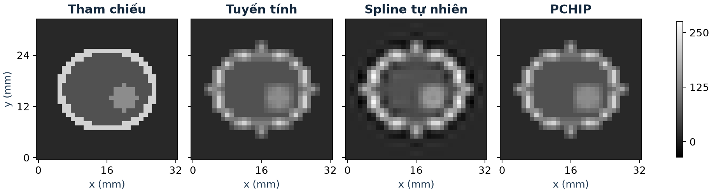

# Phóng to ảnh và tái lấy mẫu khối 3D bằng nội suy spline

*Báo cáo tóm tắt bài tập lớn môn Phương pháp tính*

## Mục tiêu và cách làm

Đề tài đánh giá chất lượng các phương pháp nội suy ảnh và xây dựng **ngưỡng dừng Gauss–Seidel từ mức sai lệch cường độ cho phép**. Thí nghiệm 2D dùng năm ảnh xám \(384\times224\), gồm ảnh biên, nét mảnh, hoa văn và hai ảnh chụp Camera, Astronaut. Mỗi ảnh được thu nhỏ bằng trung bình khối rồi phóng lại \(2\times\) hoặc \(4\times\) với cùng quy ước tâm pixel.

- **So sánh chính.** Cài đặt song tuyến tính, bicubic Keys và spline bậc ba tự nhiên. Đo MAE so với ảnh gốc sau lượng tử hóa 8 bit, đồng thời quan sát mặt cắt để phát hiện dao động quanh biên.
- **Giải hệ spline.** Từ điều kiện ghép đạo hàm và biên tự nhiên, lập hệ ba đường chéo \(A=\operatorname{tridiag}(1,4,1)\) trên lưới nút đơn vị. Giải trực tiếp bằng Thomas làm mốc và giải lặp bằng Gauss–Seidel để thử các ngưỡng phần dư.
- **Mở rộng.** Thêm nội suy Hermite đơn điệu PCHIP để kiểm tra khả năng giữ dải cường độ. Thử phân bổ sai lệch cho từng trục để giảm số lần cập nhật ẩn. Áp dụng các phép so sánh trên khối voxel tổng hợp.

## Kết quả toán học và thí nghiệm 2D

Đã chứng minh tính hội tụ của Gauss–Seidel trên hệ spline và các chặn sau, với \(R_a\) là phần dư lớn nhất ở lượt theo trục \(a\).

$$
E_{1D}\le \frac{R_x}{16},\qquad
E_{2D}\le \frac{2{,}5R_x+R_y}{16},\qquad
E_{3D}\le \frac{6{,}25R_x+2{,}5R_y+R_z}{16}.
$$

Các chặn đo sai lệch cực đại **so với Thomas trên cùng mô hình spline, trước lượng tử hóa**. Chặn 1D kết hợp hệ số \(1/2\) từ tính chéo trội với \(1/8\) từ trọng số spline. Trong 3D, sai lệch của lượt đầu đi qua hai lượt nội suy chính xác còn lại, tạo hệ số \(2{,}5^2=6{,}25\). Nếu dành tỷ lệ \(\alpha_a\) của mức sai lệch \(\delta\) cho trục \(a\), đặt ngưỡng phần dư \(\tau_a=16\delta\alpha_a/w_a\), với \(w_a\) là hệ số tương ứng trong chặn và \(\sum_a\alpha_a=1\).

| Thí nghiệm | Kết quả chính |
|---|---|
| 30 phép đo MAE cơ bản | Trong ba phương pháp chính, Keys có MAE thấp nhất ở 4/10 cặp ảnh–mức phóng, spline tự nhiên ở 6/10 cặp. |
| Kiểm chứng chặn 1D | Hàng biên \(4\times\), \(\delta=0{,}1\). Gauss–Seidel dừng sau 5 vòng, sai lệch đo trên 6.081 điểm là \(0{,}01301\) mức xám. |
| Kiểm chứng chặn 2D | Ảnh hoa văn \(4\times\), \(\delta=0{,}1\). Sai lệch cực đại \(0{,}01179\) mức xám, dưới chặn \(0{,}09918\). |
| Chia ngưỡng ngang và dọc | So với mốc dùng cùng ngưỡng ở \(\delta=0{,}1\), cấu hình tốt nhất trong các ca thử giảm **2,68%** số lần cập nhật trên ảnh biên và **8,53%** trên ảnh hoa văn. |
| PCHIP ở biên ảnh | Giữ dải cường độ đầu vào qua từng lượt. Với ảnh biên \(4\times\), MAE là \(0{,}7143\), so với \(0{,}8481\) của spline tự nhiên. |

## Tái lấy mẫu và tạo lát cắt 3D

Thử nghiệm đầu nội suy giữa các lát Gaussian chỉ theo \(z\). Thử nghiệm mở rộng nội suy theo \(x\to y\to z\), từ bước voxel \(2\times2\times3\) mm sang \(1\times1\times1\) mm. Dùng hai khối tổng hợp là Gaussian trơn và phantom có vỏ sáng, biên gắt. MAE được tính trên **24.624 voxel ngoài lưới đầu vào**. Các lát axial, coronal và sagittal minh họa bước tái lấy mẫu thể tích đã tái tạo trong quy trình CT.

| Khối 3D | MAE tuyến tính | MAE spline tự nhiên | MAE PCHIP |
|---|---:|---:|---:|
| Gaussian trơn | 1,0022 | **0,0895** | 0,2856 |
| Phantom biên gắt | 11,5900 | 14,4058 | **11,2396** |

Cả **24 ca** thử ngưỡng dừng 3D đều đạt chặn. Với phantom ở \(\delta=0{,}1\), cấu hình tốt nhất trong bốn cách chia đã thử giảm **10,55%** số lần cập nhật ẩn so với mốc dùng cùng ngưỡng. Sai lệch so với Thomas là **0,02418**. Các kết quả 3D thuộc về hai khối mô phỏng với cường độ quy ước.

## Sản phẩm đã hoàn thành

- [Demo chạy offline](demo.html) để đổi phương pháp nội suy, mức phóng và cách chia ngưỡng dừng.
- [Báo cáo cơ bản](BAO_CAO_NGAY_14.md) và [báo cáo nâng cao](BAO_CAO_NANG_CAO.md) chứa chứng minh, điều kiện thí nghiệm, hình và hướng dẫn chạy lại.
- Bộ **16 slide**, [kịch bản bảo vệ](TAP_BAO_VE_NGAY_18.md), ba ảnh dự phòng và mã thực nghiệm với **9 kiểm thử tự động**.
