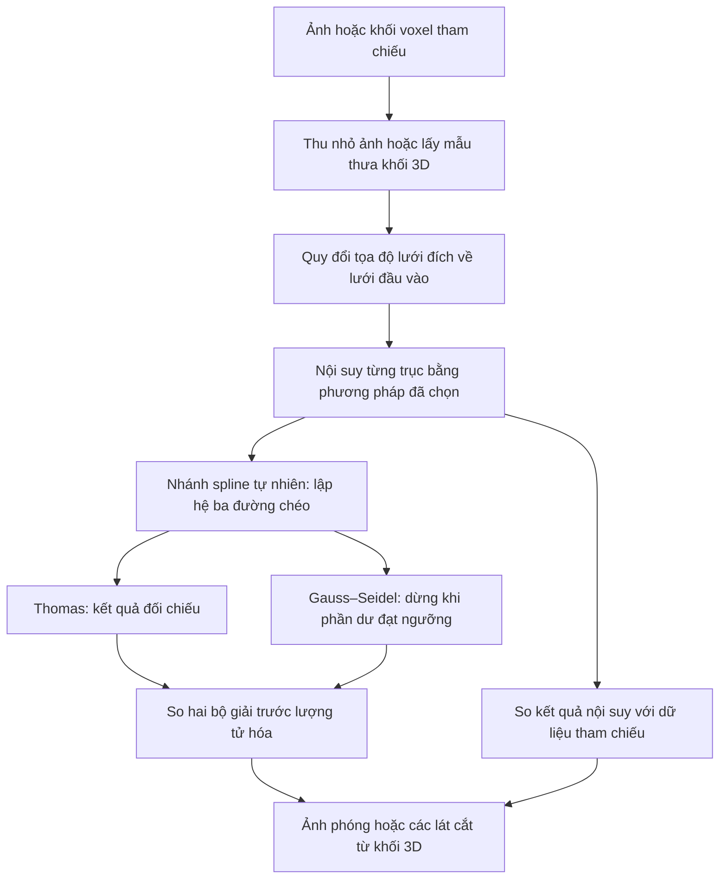
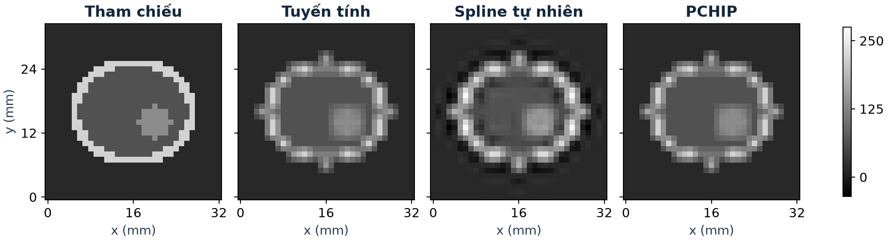

# Từ bài toán phóng ảnh đến tái lấy mẫu 3D

*Chương kỹ thuật về công thức, chứng minh và quy trình thực nghiệm*

Bài toán đầu vào là một lưới ảnh hoặc voxel có mẫu cường độ tại các vị trí đã biết. Ta cần ước lượng cường độ trên một lưới đích dày hơn. Khi dùng spline bậc ba tự nhiên, mỗi dãy mẫu dẫn đến một hệ tuyến tính ba đường chéo. Câu hỏi nghiên cứu là **với sai lệch đầu ra cho phép $`\delta`$, nên dừng Gauss–Seidel ở phần dư bao nhiêu?**

## 1. Quy trình từ dữ liệu đến kết quả



| Bước | Ảnh 2D | Khối 3D |
|---|---|---|
| **Đầu vào thí nghiệm** | Năm ảnh xám $`384\times224`$, gồm ba ảnh tổng hợp và hai ảnh chụp. Thu nhỏ bằng trung bình khối theo hệ số 2 hoặc 4. | Tạo khối Gaussian và phantom có biên gắt. Giữ mẫu trên lưới thưa để làm đầu vào, giữ lưới dày làm tham chiếu. |
| **Tọa độ truy vấn** | Ánh xạ theo tâm pixel và giới hạn tọa độ vào miền mẫu. | Quy đổi tọa độ vật lý theo bước voxel của từng trục. |
| **Thứ tự nội suy** | Theo hàng rồi theo cột. Ở mức $`4\times`$, kích thước đi từ $`96\times56`$ qua $`384\times56`$ đến $`384\times224`$. | Theo $`x\to y\to z`$. Khối $`17\times17\times9`$ đi qua $`33\times17\times9`$ và $`33\times33\times9`$, rồi thành $`33\times33\times25`$. |
| **Kiểm tra bộ giải** | So spline Gauss–Seidel với spline Thomas trên cùng ảnh nhỏ. | So hai bộ giải trên cùng khối thưa trước lượng tử hóa. |
| **Đánh giá phương pháp** | Tính MAE so với ảnh gốc và quan sát mặt cắt mức xám ở biên. | Tính MAE trên voxel ngoài lưới đầu vào và so các lát ngang, trán, dọc. |

Trong ứng dụng phóng ảnh, ảnh độ phân giải thấp là đầu vào trực tiếp. Bước thu nhỏ trong thí nghiệm tạo một đầu vào chung và cho phép đối chiếu với ảnh gốc. Trong ứng dụng 3D, đầu vào là thể tích voxel đã tái tạo. Nội suy cung cấp cường độ tại các vị trí cần hiển thị giữa những mẫu đã có.

## 2. Tạo ảnh nhỏ, ánh xạ tọa độ và nội suy

Gọi $`I[j,i]`$ là ảnh tham chiếu, với chỉ số hàng trước và cột sau. Khi thu nhỏ theo hệ số $`s`$, mỗi mẫu của ảnh nhỏ $`D_s`$ là trung bình của một khối $`s\times s`$ không chồng lấn.

```math
D_s[j,i]=\frac{1}{s^2}\sum_{a=0}^{s-1}\sum_{b=0}^{s-1}
I[sj+a,si+b].
```

Với hai ảnh chụp, bước chuẩn bị cắt vùng giữa ảnh và tính mức xám bằng cách làm tròn $`0{,}299R+0{,}587G+0{,}114B`$. Ảnh biên tổng hợp chuyển từ mức 38 sang 216 tại $`x_{\mathrm{biên}}(y)=190+0{,}55\max(0,y-104)`$. Ở đoạn biên thẳng, khối ngang $`x=188,\ldots,191`$ chứa hai mẫu mỗi mức và cho trung bình 127. [Quy tắc chuẩn bị ảnh](prepare_data.py) · [Cách tạo ảnh tổng hợp](src/interpolation.mjs)

Tâm pixel đầu ra ở cột $`u`$, hàng $`v`$ tương ứng với tọa độ $`x=(u+0{,}5)/s-0{,}5`$ và $`y=(v+0{,}5)/s-0{,}5`$ trên ảnh nhỏ. Ví dụ, với $`s=4`$ và $`u=10`$, ta được $`x=2{,}125`$, nằm giữa hai mẫu có chỉ số 2 và 3. Chương trình giữ số thực giữa các lượt và chỉ lượng tử hóa ảnh cuối để hiển thị hoặc tính MAE 2D.

### Song tuyến tính và bicubic Keys

Trên một trục, đặt $`x=i+t`$ với $`t\in[0,1]`$. Nội suy tuyến tính cho $`L(x)=(1-t)f_i+t f_{i+1}`$. Nếu $`p,q`$ là phần lẻ theo hai trục thì bốn trọng số song tuyến tính là

```math
(1-p)(1-q),\qquad p(1-q),\qquad (1-p)q,\qquad pq.
```

Các trọng số không âm và có tổng bằng một. Vì vậy, giá trị đầu ra nằm trong dải của bốn mẫu dùng để tính.

Bicubic Keys lấy bốn mẫu trên mỗi trục. Đặt $`q=\lvert d\rvert`$ với $`d`$ là khoảng cách đến tâm mẫu và chọn $`a=-0{,}5`$.

```math
K(d)=
\begin{cases}
(a+2)q^3-(a+3)q^2+1, & 0\le q<1,\\
aq^3-5aq^2+8aq-4a, & 1\le q<2,\\
0, & q\ge2.
\end{cases}
```

Giá trị trên một trục là $`\sum_i w_if_i`$, với $`w_i=K(x-i)/\sum_jK(x-j)`$ và hai tổng cùng lấy trên các chỉ số lân cận. Khi một chỉ số nằm ngoài ảnh, chương trình đọc giá trị tại mép gần nhất và giữ nguyên khoảng cách dùng để tính trọng số. Tích trọng số theo hai trục cho vùng $`4\times4`$. Trọng số âm có thể làm cường độ vượt dải quanh biên. [Bài báo của Keys](https://ncorr.com/download/publications/keysbicubic.pdf)

Demo còn có láng giềng gần nhất, lấy mẫu tại $`\lfloor x+0{,}5\rfloor`$, và Lanczos‑3, dùng trọng số chuẩn hóa từ $`\operatorname{sinc}(d)\operatorname{sinc}(d/3)`$ khi $`\lvert d\rvert\lt3`$. Trọng số Lanczos bằng 0 ngoài miền đó. Hàm $`\operatorname{sinc}(d)=\sin(\pi d)/(\pi d)`$ lấy giá trị 1 tại $`d=0`$. [Mã các phương pháp nội suy](src/interpolation.mjs) · [Getreuer, *Linear Methods for Image Interpolation*](https://www.ipol.im/pub/art/2011/g_lmii/)

### PCHIP và chứng minh giữ dải

Với bước nút bằng 1, đặt $`s_i=f_{i+1}-f_i`$. Độ dốc $`d_i`$ tại nút trong là trung bình điều hòa của hai sai phân kề khi chúng cùng dấu và khác 0.

```math
d_i=
\begin{cases}
\dfrac{2}{1/s_{i-1}+1/s_i}, & s_{i-1}s_i>0,\\[4pt]
0, & s_{i-1}s_i\le0.
\end{cases}
```

Ở đầu trái, dùng ước lượng $`(3s_0-s_1)/2`$. Đặt độ dốc bằng 0 nếu dấu khác $`s_0`$ và giới hạn độ lớn ở $`3\lvert s_0\rvert`$. Đầu phải xử lý đối xứng. Với hai mẫu, PCHIP cho đoạn thẳng. Với một mẫu, kết quả là hằng số.

Đặt $`t=x-i`$ và $`u=1-t`$. Đoạn Hermite nội suy giá trị và độ dốc ở hai đầu.

```math
H_i(t)
=(1+2t)u^2f_i+(3-2t)t^2f_{i+1}
+tu^2d_i-t^2ud_{i+1}.
```

Nếu $`s_i=0`$, hai độ dốc đều bằng 0 và đoạn là hằng số. Nếu $`s_i\ne0`$, đặt $`a=d_i/s_i`$ và $`b=d_{i+1}/s_i`$. Quy tắc độ dốc cho $`a,b\in[0,3]`$. Đạo hàm chuẩn hóa là

```math
\frac{H_i'(t)}{s_i}
=6t(1-t)+a(1-4t+3t^2)+b(3t^2-2t).
```

Với mỗi $`t`$, biểu thức là hàm affine theo $`(a,b)`$. Tại bốn góc $`(0,0)`$, $`(3,0)`$, $`(0,3)`$ và $`(3,3)`$, giá trị lần lượt là $`6t(1-t)`$, $`3(1-t)^2`$, $`3t^2`$ và $`3(2t-1)^2`$. Các giá trị này không âm trên $`[0,1]`$, nên đoạn đơn điệu theo chiều của $`s_i`$ và nằm trong dải của hai mẫu đầu mút. Áp dụng lần lượt theo các trục giữ dải cường độ của đầu vào trong số học chính xác. [Fritsch và Butland](https://doi.org/10.1137/0905021) · [Phép thử và mặt cắt PCHIP](BAO_CAO_NANG_CAO.md#2-pchip-và-độ-vượt-dải-ở-biên-ảnh)

## 3. Spline tự nhiên và hệ ba đường chéo

Trên một dãy $`f_0,\ldots,f_{n-1}`$ có bước nút chuẩn hóa bằng 1, gọi $`M_i=S''(i)`$. Trên đoạn $`[i,i+1]`$, đạo hàm cấp hai của spline bậc ba là $`uM_i+tM_{i+1}`$. Tích phân hai lần và yêu cầu đi qua $`f_i,f_{i+1}`$ cho

```math
S_i(x)=u f_i+t f_{i+1}
+\frac{(u^3-u)M_i+(t^3-t)M_{i+1}}{6},
\qquad t=x-i,\quad u=1-t.
\tag{1}
```

Hai đoạn kề đã dùng chung giá trị mẫu và đạo hàm cấp hai tại nút nối. Để đạo hàm cấp một cũng liên tục, cho đạo hàm từ đoạn trái và đoạn phải bằng nhau.

```math
f_i-f_{i-1}+\frac{M_{i-1}+2M_i}{6}
= f_{i+1}-f_i-\frac{2M_i+M_{i+1}}{6}.
```

Điều kiện biên tự nhiên đặt đạo hàm cấp hai ở hai đầu bằng 0. Do đó, hệ của $`n-2`$ ẩn bên trong có dạng

```math
\begin{aligned}
M_{i-1}+4M_i+M_{i+1}
  &=6(f_{i+1}-2f_i+f_{i-1})=b_i,\qquad 1\le i\le n-2,\\
M_0&=M_{n-1}=0,\qquad A=\operatorname{tridiag}(1,4,1).
\end{aligned}
\tag{2}
```

Chẳng hạn, với dãy $`(0,1,0,1)`$, vế phải là $`(-12,12)`$ và hai ẩn trong có nghiệm $`(-4,4)`$. Sau khi giải hệ, thay các $`M_i`$ vào (1) để tính mức xám ở mọi tọa độ truy vấn trên dãy. [Dẫn xuất spline của University of Utah](https://web.physics.utah.edu/~detar/phys6720/handouts/cubic_spline/cubic_spline/node1.html) · [Kiểm thử hệ hai ẩn](verify.mjs)

### Thomas làm mốc đối chiếu

Khởi tạo $`d_1=4`$ và $`q_1=b_1`$. Khi khử hàng $`i`$, hệ số nhân là $`1/d_{i-1}`$ vì phần tử dưới đường chéo bằng 1. Bước khử cập nhật đường chéo và vế phải. Bước thế lùi bắt đầu từ điều kiện $`M_{n-1}=0`$.

```math
\begin{aligned}
d_i &= 4-\frac{1}{d_{i-1}},
& q_i &= b_i-\frac{q_{i-1}}{d_{i-1}}
&& (i=2,\ldots,n-2),\\
M_i &= \frac{q_i-M_{i+1}}{d_i}
&&&& (i=n-2,\ldots,1).
\end{aligned}
```

Các phần tử trụ đều lớn hơn 3. Thật vậy, $`d_1=4`$ và nếu $`d_{i-1}\ge3`$ thì $`d_i\ge4-1/3\gt3`$. Vì vậy, các phép chia trong công thức đều xác định. Mỗi bước chỉ dùng các hệ số kề nhau nên chi phí trên một dãy là $`O(n)`$. Trong thí nghiệm, nghiệm Thomas là mốc số để đối chiếu với Gauss–Seidel.

### Gauss–Seidel và chứng minh hội tụ

Khởi tạo $`\widetilde M^{(0)}=0`$ và quét theo chỉ số tăng dần. Khi tính $`\widetilde M_i^{(k+1)}`$, giá trị bên trái đã được cập nhật, còn bên phải vẫn thuộc vòng trước.

```math
\begin{aligned}
\widetilde M_i^{(k+1)}
  &=\frac{b_i-\widetilde M_{i-1}^{(k+1)}-\widetilde M_{i+1}^{(k)}}{4},\\
r^{(k)}&=b-A\widetilde M^{(k)},\qquad
R^{(k)}=\lVert r^{(k)}\rVert_\infty.
\end{aligned}
```

Mỗi vòng có chi phí $`O(n)`$. Chương trình dừng ở vòng đầu tiên có $`R^{(k)}\le\tau`$, với giới hạn 500 vòng cho mỗi hệ. Hàng hằng có $`b=0`$ nên đạt ngưỡng ngay tại vòng 0.

Gọi $`e^{(k)}=M-\widetilde M^{(k)}`$ và $`E_k=\lVert e^{(k)}\rVert_\infty`$. Trừ bước lặp khỏi phương trình của nghiệm đúng, ta có

```math
\lvert e_i^{(k+1)}\rvert
\le \frac{\lvert e_{i-1}^{(k+1)}\rvert+\lvert e_{i+1}^{(k)}\rvert}{4}.
```

Biên trái có sai số bằng 0. Nếu thành phần vừa cập nhật bên trái không vượt $`E_k/3`$, vế phải cũng không vượt $`(E_k/3+E_k)/4=E_k/3`$. Quy nạp theo $`i`$ cho $`E_{k+1}\le E_k/3`$, nên phép lặp hội tụ trong số học chính xác. [Mã hai bộ giải](src/interpolation.mjs) · [Gauss–Seidel, Netlib](https://www.netlib.org/linalg/old_html_templates/subsection2.6.2.2.html)

## 4. Từ phần dư đến sai lệch trên ảnh và khối 3D

### Một lượt nội suy

Ở một vòng bất kỳ, đặt $`e=M-\widetilde M`$ và $`r=b-A\widetilde M=Ae`$. Chọn chỉ số $`j`$ sao cho $`\lvert e_j\rvert=\lVert e\rVert_\infty`$. Hai sai số tại nút biên bằng 0. Do đó,

```math
\lVert r\rVert_\infty\ge\lvert r_j\rvert
\ge 4\lvert e_j\rvert-\lvert e_{j-1}\rvert-\lvert e_{j+1}\rvert
\ge 2\lVert e\rVert_\infty.
```

Nếu $`Ae=0`$ thì $`e=0`$, nên hệ vuông (2) có nghiệm duy nhất. Lấy hiệu hai spline trên cùng dãy $`f`$ làm triệt tiêu phần tuyến tính trong (1). Vì $`u+t=1`$, tổng độ lớn hai trọng số của sai số độ cong là

```math
\frac{(u-u^3)+(t-t^3)}{6}
=\frac{t(1-t)}{2}\le\frac{1}{8}.
```

Với $`R=\lVert r\rVert_\infty`$, hai bất đẳng thức cho chặn trên toàn đoạn liên tục.

```math
\lVert \widetilde S-S\rVert_\infty
\le\frac{1}{8}\lVert e\rVert_\infty
\le\frac{R}{16}.
\tag{3}
```

Vì vậy, ngưỡng đủ cho một lượt là $`\tau=16\delta`$. Với hàng biên ở $`\delta=0{,}1`$, ngưỡng bằng 1,6. Vòng 5 là vòng đầu tiên đạt ngưỡng, cho sai lệch đo được 0,013005 và chặn từ phần dư thực tế là 0,040741 mức xám. [Nhật ký từng vòng](results/day14/KET_QUA_NGAY_14.json)

### Hai lượt nội suy

Gọi $`T`$ là phép spline chính xác theo một trục. Từ (2), $`\lVert b\rVert_\infty\le24\lVert f\rVert_\infty`$. Bất đẳng thức chéo trội cho $`\lVert M\rVert_\infty\le12\lVert f\rVert_\infty`$. Phần tuyến tính của (1) có chuẩn tối đa $`\lVert f\rVert_\infty`$, còn phần hiệu chỉnh bị chặn bởi $`\lVert M\rVert_\infty/8`$. Cộng lại cho

```math
\lVert Tf\rVert_\infty
\le \lVert f\rVert_\infty+\frac{\lVert M\rVert_\infty}{8}
\le 2{,}5\lVert f\rVert_\infty.
```

Đặt $`F=D_s`$ là ảnh nhỏ. Gọi $`X,Y`$ là các lượt spline chính xác theo hàng và cột, còn $`\widetilde X,\widetilde Y`$ là các lượt tính bằng Gauss–Seidel. Lấy $`R_x,R_y`$ là phần dư lớn nhất qua các hệ trong từng lượt. Tính tuyến tính của phép chính xác $`Y`$ cho

```math
\begin{aligned}
\widetilde Y(\widetilde X F)-Y(XF)
&=\bigl[\widetilde Y(\widetilde X F)-Y(\widetilde X F)\bigr]
+Y(\widetilde X F-XF),\\
E_{\mathrm{2D}} &\le \frac{R_y+2{,}5R_x}{16}.
\end{aligned}
\tag{4}
```

Số hạng đầu dùng chặn 1D vì hai lượt dọc cùng nhận $`\widetilde X F`$. Số hạng sau mang sai lệch ngang qua $`Y`$, nên có thêm hệ số $`2{,}5`$. Với ngưỡng chung $`\tau=16\delta/3{,}5`$, cả hai phần dư đạt ngưỡng thì $`E_{\mathrm{2D}}\le\delta`$.

Nếu dành tỷ lệ $`\alpha`$ cho sai lệch do lượt ngang, ta có thể đặt ngưỡng riêng mà vẫn giữ cùng bảo đảm.

```math
\tau_x=\frac{16\delta\alpha}{2{,}5},\qquad
\tau_y=16\delta(1-\alpha),\qquad 0<\alpha<1.
```

Với $`\delta=0{,}1`$ và $`\alpha=1/4`$, hai ngưỡng là $`\tau_x=0{,}16`$ và $`\tau_y=1{,}2`$. Cấu hình chung ứng với $`\alpha=5/7`$. Trên ảnh hoa văn, cấu hình $`1/4`$ giảm số cập nhật từ 166.804 xuống 152.578, còn cấu hình $`3/4`$ tăng lên 167.710. Cả hai đều đạt mục tiêu sai lệch. [Bảng thực nghiệm chia ngưỡng](BAO_CAO_NANG_CAO.md#1-chia-ngưỡng-dừng-cho-hai-lượt-nội-suy)

### Ba lượt nội suy

Thêm lượt $`Z`$ theo trục $`z`$ và đặt $`B=2{,}5`$. Lần lượt thêm rồi trừ kết quả trung gian, ta được

```math
\begin{aligned}
\widetilde Z\widetilde Y\widetilde X F-ZYXF
={}&(\widetilde Z-Z)(\widetilde Y\widetilde X F)\\
&+Z\bigl[(\widetilde Y-Y)(\widetilde X F)\bigr]\\
&+ZY\bigl[(\widetilde X-X)F\bigr].
\end{aligned}
```

Ở đây, $`F`$ là khối đầu vào thưa. Sai lệch theo $`x`$ đi qua hai phép chính xác, sai lệch theo $`y`$ đi qua một phép, còn sai lệch theo $`z`$ xuất hiện ở lượt cuối. Do đó,

```math
E_{\mathrm{3D}}
\le \frac{B^2R_x+BR_y+R_z}{16}
=\frac{6{,}25R_x+2{,}5R_y+R_z}{16}.
\tag{5}
```

Với $`w=(6{,}25,\ 2{,}5,\ 1)`$, chọn các tỷ lệ không âm có tổng bằng một và đặt $`\tau_a=16\delta\alpha_a/w_a`$. Nếu mọi lượt có $`R_a\le\tau_a`$, tổng chặn không vượt $`\delta`$. Lý luận dùng tính tuyến tính của phép spline chính xác và áp dụng trên lưới nút đơn vị của từng trục. Khi chạy chương trình, nhóm đo độ chênh với nghiệm số Thomas bằng số thực dấu phẩy động. [Các ca kiểm chứng 3D](results/advanced/KET_QUA_NANG_CAO.json)

### Chặn theo lưới đích cố định

Trên một lưới đầu ra cố định, phép spline chính xác theo cột là ma trận $`Y`$. Cột $`j`$ của $`Y`$ là kết quả nội suy vectơ đơn vị $`e_j`$. Khi đó,

```math
\lVert Y\rVert_\infty=\max_i\sum_j\lvert Y_{ij}\rvert,\qquad
E_{\mathrm{2D}}\le\frac{\lVert Y\rVert_\infty R_x+R_y}{16}.
```

Hệ số này chỉ phụ thuộc lưới, điều kiện biên và quy ước tọa độ. Với lưới dọc **56 → 224 mẫu** ở mức $`4\times`$, phép tính thử bằng phân số dùng tọa độ đích $`(2i-3)/8`$ trước khi giới hạn vào miền mẫu. Tổng trị tuyệt đối lớn nhất theo hàng bằng $`183453423966608917/121113495225517792\lt1{,}515`$.

Thay hệ số $`1{,}515`$ và **giữ nguyên phần dư đã ghi** ở ca hoa văn cho chặn 0,07134 mức xám, so với 0,09918 khi dùng hệ số 2,5. Đây là phép đối chiếu chặn trên cùng lần chạy. Demo hiện dùng hệ số 2,5. Để đo tác động lên số vòng, cần chạy riêng với ngưỡng mới $`16\delta/(1{,}515+1)`$ và đối chiếu kết quả. [Chuẩn ma trận vô cùng, Cornell](https://www.cs.cornell.edu/courses/cs4220/2026sp/lec/2026-01-30.html)

## 5. Các đại lượng dùng để đọc kết quả

| Đại lượng | Công thức | Cách đọc |
|---|---|---|
| **MAE của ảnh 2D** | $`\operatorname{MAE}=\frac{1}{WH}\sum_{j,i}\lvert Q(\widehat I[j,i])-I[j,i]\rvert`$ | So ảnh phóng với ảnh gốc. $`Q(z)=\lfloor\min(255,\max(0,z))+0{,}5\rfloor`$ đưa kết quả về ảnh xám 8 bit. |
| **MAE trên khối 3D** | $`\operatorname{MAE}=\frac{1}{N}\sum_{v\in\Omega}\lvert \widehat F(v)-F_{\mathrm{ref}}(v)\rvert`$ | $`\Omega`$ gồm các voxel dành cho kiểm tra, $`N`$ là số voxel trong tập đó. So cường độ số thực với khối tham chiếu. |
| **Sai lệch bộ giải** | $`E=\lVert S_{\mathrm{GS}}-S_{\mathrm{Thomas}}\rVert_\infty`$ | Đo chênh lệch cực đại giữa hai cách tính cùng spline, trước lượng tử hóa. |
| **Mức vượt dải** | $`O=\max(0,L-\min\widehat f,\max\widehat f-U)`$ | $`[L,U]`$ là dải làm mốc cho ca thử. Với PCHIP trên toàn ảnh, lấy min và max của ảnh nhỏ. Với mặt cắt biên trong báo cáo chính, dùng dải tham chiếu $`[38,216]`$. |
| **Số cập nhật ẩn** | $`W_{\mathrm{upd}}=\sum_j n_j k_j`$ | Hệ $`j`$ có $`n_j`$ ẩn và dùng $`k_j`$ vòng. Đại lượng này đếm cập nhật trong phép lặp. |

MAE và sai lệch bộ giải dùng hai mốc khác nhau. Trên phantom, spline tự nhiên có MAE **14,4058** so với khối tham chiếu. Cấu hình Gauss–Seidel được chọn ở $`\delta=0{,}1`$ chỉ lệch tối đa **0,02418** so với Thomas. Điều này cho thấy bộ giải đã tính sát spline, còn khả năng tái hiện biên phụ thuộc vào phương pháp nội suy và dữ liệu thưa. Sai lệch dưới một mức xám vẫn có thể làm hai giá trị rơi vào hai phía của ngưỡng làm tròn.

## 6. Từ thí nghiệm đến ứng dụng

### Phóng ảnh 2D

1. Nhận ảnh xám và xác định kích thước đích. Trong bộ thử hiện có, chương trình nhận một ảnh nhỏ đã tạo từ ảnh tham chiếu.
2. Dùng tọa độ tâm pixel để tìm vị trí truy vấn trên từng hàng, sau đó nội suy theo cột. Với spline, chọn Thomas hoặc đặt $`\delta`$ để suy ra ngưỡng Gauss–Seidel.
3. Giữ ảnh số thực để kiểm tra sai lệch bộ giải. Lượng tử hóa để tạo ảnh hiển thị. Nếu có ảnh tham chiếu cùng kích thước, tính MAE và đọc thêm mặt cắt để xác định vị trí dao động quanh biên.

Ở ca hoa văn phóng $`4\times`$ với $`\delta=0{,}1`$, lượt ngang giải 56 hệ có 94 ẩn mỗi hệ và lượt dọc giải 384 hệ có 54 ẩn mỗi hệ. Với ngưỡng chung $`\tau\approx0{,}45714`$, chương trình ghi tổng cộng 355 vòng theo hàng và 2.471 vòng theo cột. Vì vậy, số cập nhật ẩn là $`94\cdot355+54\cdot2471=166\,804`$. Từ $`R_x\approx0{,}45221`$ và $`R_y\approx0{,}45641`$, công thức (4) cho chặn 0,099184 mức xám. Sai lệch đo trên ảnh đầu ra là 0,011788 mức xám. [Dữ liệu của ca hoa văn](results/day14/KET_QUA_NGAY_14.json)

Trên năm ảnh và hai mức phóng, bicubic Keys có MAE thấp nhất ở 4/10 cặp trong ba phương pháp cơ sở, còn spline tự nhiên dẫn đầu ở 6/10 cặp. Phép thử bổ sung trên ảnh biên $`4\times`$ cho MAE 0,7143 với PCHIP và 0,8481 với spline tự nhiên. [Bảng 30 phép đo MAE](results/KET_QUA.md) · [Hình so sánh phóng 4 lần](results/day14/bo-anh-so-sanh-4x.png)

### Tái lấy mẫu khối 3D và hiển thị lát trung gian

1. Nhận khối voxel đã tái tạo, kèm gốc tọa độ và bước mẫu theo từng trục. Với lưới đều thẳng trục như mô phỏng, một tọa độ vật lý $`q_a`$ được đưa về chỉ số mẫu bằng $`p_a=(q_a-o_a)/h_a`$, với $`o_a`$ là gốc và $`h_a`$ là bước trên trục đó.
2. Chọn lưới đích. Thí nghiệm nâng cao đi từ bước $`2\times2\times3`$ mm sang $`1\times1\times1`$ mm. Giữ đơn vị mm khi xác định vị trí và dùng $`p_x=x/2`$, $`p_y=y/2`$, $`p_z=z/3`$ khi tính trên lưới nút đơn vị.
3. Nội suy từng dãy theo $`x\to y\to z`$. So sánh tuyến tính, spline tự nhiên và PCHIP. Nếu dùng Gauss–Seidel, đặt ba ngưỡng theo (5). Trong mô phỏng, chương trình giữ lại 2.601 voxel đã lấy mẫu và đánh giá MAE trên 24.624 voxel còn lại.
4. Trích lát ngang tại $`z=11`$ mm, lát trán tại $`y=15`$ mm và lát dọc tại $`x=17`$ mm. Lát ngang nằm giữa hai lát đầu vào ở $`z=9`$ và $`z=12`$ mm.

Thí nghiệm ban đầu chỉ nội suy theo $`z`$ trên Gaussian. Với

```math
G(x,y,z)=200\exp\left(
-\frac{(x-8)^2+(y-8)^2}{24}
-\frac{(z-6)^2}{8}
\right),
```

lưới đầu vào giữ các lát $`z=0,3,6,9,12`$ mm. MAE trên tám lát trung gian là 4,070801 với tuyến tính và 0,369592 với spline.

Thí nghiệm ba trục dùng một Gaussian trơn $`G_2`$ và một phantom xác định theo hai ellipsoid $`\rho`$ và $`\eta`$.

```math
\begin{aligned}
G_2(x,y,z)&=200\exp\left(-\frac{(x-16)^2+(y-16)^2}{80}
                         -\frac{(z-12)^2}{24}\right),\\
\rho(x,y,z)&=\left(\frac{x-16}{12}\right)^2
             +\left(\frac{y-16}{10}\right)^2
             +\left(\frac{z-12}{9}\right)^2,\\
\eta(x,y,z)&=\left(\frac{x-20}{3}\right)^2
             +\left(\frac{y-14}{3}\right)^2
             +\left(\frac{z-11}{4}\right)^2.
\end{aligned}
```

Phantom có nền 15 khi $`\rho\gt1`$, vỏ 220 khi $`0{,}73\le\rho\le1`$ và lõi 65 khi $`\rho\lt0{,}73`$. Phần lõi thỏa $`\eta\le1`$ có mức 135. Trên Gaussian trơn, spline có MAE thấp nhất. Trên phantom biên gắt, PCHIP có MAE thấp nhất. Cả hai khối dùng cường độ quy ước. [Mô phỏng theo một trục](run_3d.mjs) · [Mô phỏng theo ba trục](run_advanced.mjs) · [Kết quả và hình 3D](BAO_CAO_NANG_CAO.md#3-tái-lấy-mẫu-khối-phantom-và-tạo-lát-cắt) · [Tài liệu tái lấy mẫu của 3D Slicer](https://slicer.readthedocs.io/en/latest/user_guide/modules/resamplescalarvolume.html)



## 7. Đối chiếu từng bước với mã và dữ liệu

| Phần cần kiểm tra | Tệp |
|---|---|
| Tạo ảnh tham chiếu và ghi nguồn | [prepare_data.py](prepare_data.py) · [manifest.json](data/manifest.json) |
| Ánh xạ tọa độ, nội suy, lập hệ và giải hệ | [interpolation.mjs](src/interpolation.mjs) |
| MAE 2D và phần dư trên ba hàng đối chứng | [run_experiments.mjs](run_experiments.mjs) · [results.json](results/results.json) |
| Kiểm chứng chặn 1D và 2D trên lưới dày và toàn ảnh | [run_day14.mjs](run_day14.mjs) · [kết quả ngày 14](results/day14/KET_QUA_NGAY_14.json) |
| Chia ngưỡng, PCHIP và 24 ca kiểm chứng 3D | [run_advanced.mjs](run_advanced.mjs) · [kết quả nâng cao](results/advanced/KET_QUA_NANG_CAO.json) |
| Trình bày và chạy lại | [Demo offline](demo.html) · [Kịch bản bảo vệ](TAP_BAO_VE_NGAY_18.md) · [Hướng dẫn chạy](../README.md#chạy-lại-thí-nghiệm) |
